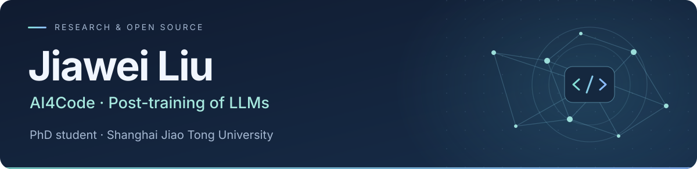

<a href="https://awgiagia.github.io/">
  <picture>
    <source media="(max-width: 600px)" srcset="assets/header-mobile.svg" />
    
  </picture>
</a>

## About me

I'm **Jiawei Liu (刘嘉伟)**, a second-year PhD student at **Shanghai Jiao Tong University (SJTU)**. My research interests lie in **AI4Code** and **post-training of LLMs**.

I am advised by [Prof. Muning Wen](https://morning9393.github.io/), [Prof. Ying Wen](https://yingwen.io/en/), and [Prof. Yun Lin](http://linyun.info/index.html). Previously, I received my B.E. from Wuhan University, advised by [Prof. Run Wang](https://wangrun.github.io/).

## Selected research

**[MemT-1.0 · Towards Memory-Native Evolution](https://arxiv.org/pdf/2610.26825)**  
**Jiawei Liu** (MemTensor Team) · Technical Report 2026 &nbsp;   
[Technical report](https://arxiv.org/pdf/2610.26825) · [Project](https://github.com/MemTensor/MemT-1.0)

**[IssueExec · A Test-Driven Approach for Localizing Software Engineering Issues](https://arxiv.org/pdf/2607.17286)**  
**ISSTA 2026** · First author  
[Paper](https://arxiv.org/pdf/2607.17286) · [Code](https://github.com/code-philia/IssueExec)

**[EditFlow · Benchmarking and Optimizing Code Edit Recommendation Systems via Reconstruction of Developer Flows](https://dl.acm.org/doi/abs/10.1145/3798249)**  
**OOPSLA 2026**  
[Paper](https://dl.acm.org/doi/abs/10.1145/3798249)

[More publications on my homepage ↗](https://awgiagia.github.io/#-publications)

